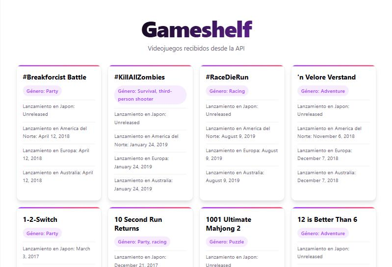
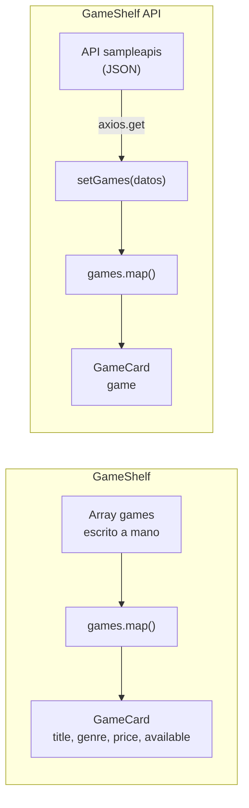
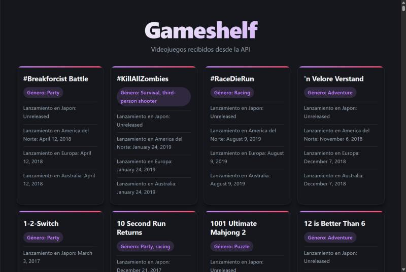
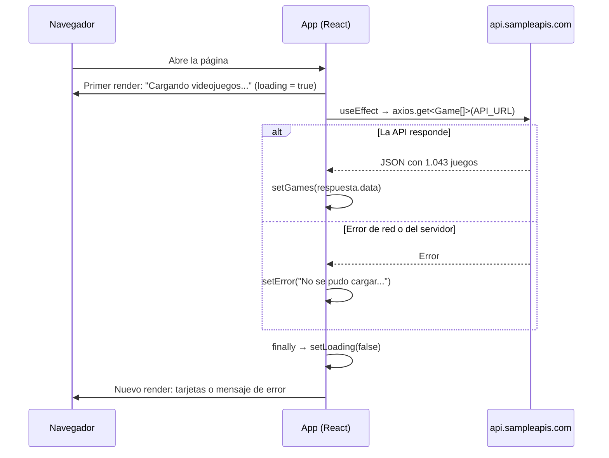

# Actividad 03: GameShelf API, el catálogo carga sus juegos desde una API

**Autor:** Alejandro Donate García · 2º DAM · Programación multimedia y dispositivos móviles (UT2)
**Repositorio:** [alejandroDonGar/Programacion-multimedia-y-dispositivos-moviles-2026---2027](https://github.com/alejandroDonGar/Programacion-multimedia-y-dispositivos-moviles-2026---2027/tree/main/ut2-react-native/gameshelfAPI) (carpeta `ut2-react-native/gameshelfAPI`)
**Proyecto anterior:** [`gameshelf`](../gameshelf/README.md), el catálogo con los juegos escritos a mano.

## Descripción

**GameShelf API** es la segunda versión de GameShelf. La interfaz sigue siendo una cuadrícula de tarjetas hecha con **React + TypeScript** (Vite), pero los juegos **ya no están escritos a mano en el código**: al abrir la página, la aplicación pide el catálogo a una API pública con **axios** y pinta una tarjeta por cada juego que llega.

* **API usada:** [`https://api.sampleapis.com/switch/games`](https://api.sampleapis.com/switch/games), con **1.043 juegos de Nintendo Switch** (dato comprobado el 27/10/2026).
* **Cada tarjeta muestra:** nombre, géneros y fecha de lanzamiento en Japón, Norteamérica, Europa y Australia.
* **Mientras carga** aparece "Cargando videojuegos..."; **si la API falla**, un mensaje de error; **si llega vacía**, un aviso.



*El catálogo con los datos que devuelve la API (modo claro).*

## Herramientas usadas y cómo ejecutarlo

| Herramienta | Para qué se usa |
|-|-|
| Node.js y npm | Ejecutar JavaScript fuera del navegador e instalar las dependencias |
| Vite 8 | Servidor de desarrollo y compilación |
| React 19 | Biblioteca para construir la interfaz con componentes |
| TypeScript 6 | Tipado estático: el tipo `Game` describe cómo es cada juego de la API |
| **axios** | **Nuevo:** librería para hacer peticiones HTTP a la API |
| API de sampleapis | Fuente de los datos (JSON con los juegos) |

```bash
npm install
npm run dev
```

Y abrir la URL que imprime Vite (normalmente `http://localhost:5173/`). Si ese puerto está ocupado, Vite usa el siguiente libre (`5174`, `5175`...).

axios se añadió al proyecto con:

```bash
npm install axios
```

> **Ojo con WSL y Windows:** `node_modules` guarda programas compilados para el sistema donde se hizo `npm install`. Si se instala desde WSL (Linux) y luego se ejecuta `npm run dev` desde PowerShell (Windows), sale `"vite" no se reconoce como un comando interno o externo`. Hay que instalar y ejecutar siempre desde la misma terminal (o borrar `node_modules` y repetir `npm install`).

---

# De GameShelf a GameShelf API: qué ha cambiado

| | GameShelf (antes) | GameShelf API (ahora) |
|-|-|-|
| **Origen de los datos** | Array `games` escrito a mano en `App.tsx` | Petición HTTP a una API al abrir la página |
| **Número de juegos** | 13 | 1.043 |
| **Tipo `Game`** | Inventado por mí (`title`, `price`, `available`...) | Copia la forma del JSON de la API (`name`, `genre`, `releaseDates`) |
| **Dónde está el tipo** | Dentro de `App.tsx` | En su propio archivo `src/types/Game.ts` |
| **Cómo se crean los objetos** | Escribiendo cada `{ id: 1, title: ... }` | Los crea `axios` a partir del JSON: no se escribe ninguno |
| **Props de `GameCard`** | Una prop por dato (`title`, `genre`, `price`, `available`) | Una sola prop: el objeto `game` entero |
| **Hooks de React** | `useState` (filtros) | `useState` (datos, carga y error) + **`useEffect`** (petición) |
| **Estados de la pantalla** | Siempre hay datos | Cargando, error, vacío o catálogo |
| **Filtros** | Disponibles y menos de 15 € | Eliminados: la API no tiene precio ni disponibilidad |



## 1. Antes: los datos escritos a mano

En el primer GameShelf, el tipo y los datos vivían dentro de `App.tsx`, y cada juego se creaba a mano:

```tsx
type Game = {
  id: number;
  title: string;
  genre: string;
  price: number;
  available: boolean;
}

const games: Game[] = [
  { id: 1, title: "Hollow Knight", genre: "Aventura", price: 14.99, available: true },
  { id: 2, title: "Celeste", genre: "Plataformas", price: 19.99, available: true },
  // ... así hasta 13
];
```

**Problema:** para añadir, quitar o corregir un juego había que **cambiar el código** y volver a compilar. Con 13 juegos es manejable; con 1.000 no.

## 2. Ahora: los datos vienen de una API

### ¿Qué es una API?

* **API** (*Application Programming Interface*): una "puerta" que ofrece un servidor para que otros programas le pidan datos.
* **Endpoint:** cada URL concreta de la API. Aquí se usa `https://api.sampleapis.com/switch/games`.
* **JSON** (*JavaScript Object Notation*): el formato de texto en el que responde. Se parece a los objetos de JavaScript, por eso es tan fácil de usar desde React.

Si se abre la URL en el navegador, se ve directamente la respuesta: un **array de objetos**, uno por juego. Por ejemplo, el segundo:

```json
{
  "id": 2,
  "name": "#KillAllZombies",
  "genre": ["Survival", "third-person shooter"],
  "developers": ["Beatshapers"],
  "publishers": ["Beatshapers"],
  "releaseDates": {
    "Japan": "Unreleased",
    "NorthAmerica": "January 24, 2019",
    "Europe": "January 24, 2019",
    "Australia": "January 24, 2019"
  }
}
```

## 3. El tipo `Game`: la nueva forma de construir los objetos

Este es el cambio más importante. Antes **yo decidía** cómo era un juego y lo rellenaba a mano. Ahora es al revés: **miro cómo es el JSON de la API y escribo un tipo con la misma forma**. Está en su propio archivo, `src/types/Game.ts`, para que lo puedan importar `App` y `GameCard`:

```ts
export type Game = {
    id: number;
    name: string;
    genre?: string[];
    releaseDates: {
        Japan?: string;
        NorthAmerica?: string;
        Europe?: string;
        Australia?: string;
    };
};
```

* **Los nombres tienen que coincidir exactamente con los del JSON.** Si el JSON dice `name`, el tipo dice `name` (no `title`). Si dice `Japan`, el tipo dice `Japan` (no `Japon`). Ver *Dificultades y soluciones*.
* **`genre?: string[]`**: los corchetes indican que es un **array de textos**, porque un juego puede tener varios géneros. La `?` indica que el campo es **opcional**: puede no venir.
* **`releaseDates: { ... }`**: un objeto dentro de otro, igual que en el JSON.
* **Solo se declaran los campos que se usan.** La API también manda `developers` y `publishers`; como no se muestran, no hace falta ponerlos.

### ¿Quién crea entonces los objetos?

Nadie los escribe: los crea **axios**. Cuando llega la respuesta, axios convierte el texto JSON en objetos de JavaScript. Al escribir `axios.get<Game[]>(...)` le digo a TypeScript "lo que va a llegar es un array de `Game`". A partir de ahí, el editor autocompleta `game.name`, `game.releaseDates.Europe`, etc., y avisa si escribo un campo que no existe.

> **Importante:** TypeScript **no comprueba** en tiempo de ejecución que la API mande de verdad lo que dice el tipo. El tipo es una **promesa que le hago al compilador**. Si me equivoco al escribirlo (como con `Japon`), el código compila pero el dato sale `undefined`. Por eso hay que mirar el JSON real antes de escribir el tipo.

## 4. La petición: `useEffect`, `async`/`await` y axios

```tsx
const API_URL = "https://api.sampleapis.com/switch/games";

useEffect(() => {
  async function loadGames() {
    try {
      const respuesta = await axios.get<Game[]>(API_URL);
      setGames(respuesta.data);
    } catch (error) {
      console.error(error);
      setError("No se pudo cargar el catálogo. Inténtelo de nuevo más tarde.")
      setLoading(false);
    } finally {
      setLoading(false);
    }
  }
  loadGames();
}, []);
```

* **`useEffect(() => {...}, [])`**: ejecuta el código **después** de que el componente se pinta por primera vez. El array vacío `[]` del final significa "solo una vez, al montar el componente". Sin él, cada cambio de estado volvería a pedir los datos y entraría en un bucle infinito (pedir → `setGames` → renderizar → pedir...).
* **Promesa:** un objeto que representa un resultado que **todavía no ha llegado** (la respuesta tarda unos milisegundos en volver del servidor). Puede cumplirse (llegan los datos) o rechazarse (error de red, servidor caído...).
* **`async` / `await`**: `await` espera a que la promesa se cumpla sin bloquear la página. Solo se puede usar dentro de una función `async`. Por eso se crea `loadGames` dentro del `useEffect` y se llama justo después: la función que recibe `useEffect` no puede ser `async` directamente.
* **`try` / `catch` / `finally`**: `try` intenta la petición; si algo falla, salta a `catch`, que guarda el mensaje de error; `finally` se ejecuta **siempre**, haya ido bien o mal, así que es el sitio para poner `setLoading(false)`.
* **`respuesta.data`**: axios mete el contenido de la respuesta en la propiedad `data`, ya convertido de JSON a objetos.

### ¿Por qué axios y no `fetch`?

En la mini-Pokédex de la UT1 se usó `fetch`, que viene con el navegador. axios hace lo mismo con menos código:

| | `fetch` | `axios` |
|-|-|-|
| Instalación | Viene con el navegador | `npm install axios` |
| Convertir JSON | A mano: `await respuesta.json()` | Automático: `respuesta.data` |
| Errores HTTP (404, 500) | **No** los lanza: hay que comprobar `respuesta.ok` | Los lanza solos y saltan al `catch` |
| Tipar la respuesta | `const datos: Game[] = await respuesta.json()` | `axios.get<Game[]>(url)` |

```js
// Con fetch (mini-Pokédex)
const respuesta = await fetch(url);
if (!respuesta.ok) {
    throw new Error("Pokémon no encontrado");
}
const datos = await respuesta.json();
```

```tsx
// Con axios (GameShelf API)
const respuesta = await axios.get<Game[]>(API_URL);
setGames(respuesta.data);
```

## 5. Los tres estados y el renderizado condicional

```tsx
const [games, setGames] = useState<Game[]>([]);
const [loading, setLoading] = useState(true);
const [error, setError] = useState<string | null>(null);
```

| Estado | Valor inicial | Para qué sirve |
|-|-|-|
| `games` | `[]` (array vacío) | Los juegos que devuelve la API |
| `loading` | `true` | La página empieza "cargando" porque la petición sale nada más abrirla |
| `error` | `null` | `null` = no hay error; si falla, guarda el texto que se muestra |

* **`useState<Game[]>([])`**: entre `< >` se indica el tipo del estado. Hace falta porque, con un array vacío, TypeScript no puede adivinar qué tipo de elementos tendrá.
* **`string | null`**: el `|` significa "o". El error es un texto **o** nada.

En el JSX, cada mensaje se pinta solo si se cumple su condición. **`condición && <elemento>`** significa "si la condición es verdadera, pinta el elemento; si no, nada":

```tsx
{loading && <p role="status">Cargando videojuegos...</p>}

{error && <p role="alert">{error}</p>}

{!loading && !error && games.length === 0 && (
  <p>La API no ha devuelto ningun videojuego</p>
)}

{!loading && !error && games.length > 0 && (
  <section className="catalog">
    {games.map((game) => (
      <GameCard key={game.id} game={game}/>
    ))}
  </section>
)}
```

* `role="status"` y `role="alert"` avisan a los lectores de pantalla de que ese texto es un aviso de estado o de error (accesibilidad).
* El `map()` y el `key` funcionan igual que en el GameShelf anterior; la diferencia es que ahora `games` sale del estado y no de un array fijo.

## 6. `GameCard` recibe el objeto entero

**Antes**, `App` pasaba cada dato por separado, y `GameCardProps` repetía los mismos campos que `Game`:

```tsx
<GameCard key={game.id} title={game.title} genre={game.genre}
          price={game.price} available={game.available} />
```

**Ahora** se pasa el objeto completo y `GameCardProps` reutiliza el tipo `Game` importado:

```tsx
<GameCard key={game.id} game={game}/>
```

```tsx
import type { Game } from "../types/Game";

type GameCardProps = {
    game: Game;
};

export default function GameCard({ game }: GameCardProps) {
    return (
        <article className="card">
            <h2>{game.name}</h2>
            <p>Género: {game.genre?.join(", ") ?? "Sin género disponible"}</p>
            <p>
                Lanzamiento en Japon: {""}
                {game.releaseDates?.Japan ?? "Sin dato disponible"}
            </p>
            {/* ... igual para NorthAmerica, Europe y Australia */}
        </article>
    )
}
```

* **Ventaja:** si mañana se muestra un dato nuevo de la API, solo se añade al tipo y a la tarjeta; `App` no cambia.
* **`import type`**: importa solo el tipo. No genera código en el JavaScript final, porque los tipos desaparecen al compilar.
* **`?.` (encadenamiento opcional)**: `game.genre?.join(...)` significa "si `genre` existe, llama a `join`; si es `undefined`, devuelve `undefined` sin romper". Sin la `?`, un juego sin géneros haría fallar la página entera.
* **`??` (operador de fusión nula)**: "si lo de la izquierda es `null` o `undefined`, usa lo de la derecha". Así sale "Sin dato disponible" en lugar de un hueco vacío.
* **`join(", ")`**: une los elementos del array en un texto, poniendo `", "` entre ellos: `["Party", "racing"]` → `"Party, racing"`.
* **`{""}`**: un texto vacío para que JSX respete el espacio después de los dos puntos.

## 7. Estilos

El `App.css` se reescribió para las clases que usa ahora el TSX (`app`, `catalog` y `card`). Tenía reglas del GameShelf anterior que ya no correspondían a ningún elemento (`.genre`, `.price`, botones de compra y de filtro, `.contador`), y la regla `.app p { margin-bottom: 48px }` se aplicaba también a los `<p>` de dentro de las tarjetas, dejando huecos enormes.

| Selector | Para qué sirve |
|-|-|
| `.app` | Centra la página con un ancho máximo de 1200 px |
| `.app > h1` | Título con degradado (`background-clip: text`). El `>` hace que afecte solo al hijo directo |
| `.app > p` | Subtítulo y mensajes de estado, **sin** tocar los `<p>` de las tarjetas |
| `.app > p[role="status"]`, `[role="alert"]` | Pastillas de "Cargando..." (con animación `latido`) y de error (en rojo) |
| `.catalog` | Cuadrícula responsiva con `repeat(auto-fill, minmax(260px, 1fr))` |
| `.card`, `.card::before`, `.card:hover` | Tarjeta con franja de color arriba (pseudoelemento `::before`), que sube 4 px al pasar el ratón |
| `.card p` | Cada fecha, separada por una línea fina |
| `.card h2 + p` | El `<p>` que va **justo después** del título (el género), en forma de etiqueta |

Los colores salen de las variables de `index.css` (`--accent`, `--border`, `--text`...), así que el modo oscuro funciona solo:



*El mismo catálogo con el tema oscuro del sistema.*

---

# Flujo completo de la aplicación



# Dificultades y soluciones

| Problema | Causa | Solución |
|-|-|-|
| Japón siempre decía "Sin dato disponible" | En el tipo y en la tarjeta escribí `Japon`, pero la API manda `Japan`. Ese campo no existía, así que siempre valía `undefined` | Cambiar a `Japan` en `Game.ts` y en `GameCard.tsx` |
| Los géneros salían pegados: "Survivalthird-person shooter" | `genre` es un array y React junta sus elementos sin separador. El tipo decía `string` | Tipo `genre?: string[]` y en la tarjeta `game.genre?.join(", ")` |
| Los estilos no se aplicaban bien | El CSS era el del GameShelf anterior; `.app p` afectaba también a las tarjetas | Reescribir `App.css` con las clases nuevas y usar `.app > p` |
| `"vite" no se reconoce como un comando interno o externo` | `npm install` hecho en WSL (Linux) y `npm run dev` en PowerShell (Windows) | Instalar y ejecutar desde la misma terminal |
| Al abrir `localhost:5173` salía otro proyecto | Había otro servidor de Vite ocupando ese puerto | Parar el otro servidor con `Ctrl + C`, o abrir la URL que imprime `npm run dev` |

**Lección principal:** antes de escribir el tipo, hay que abrir la URL de la API y mirar el JSON real: los nombres exactos de los campos y si cada uno es un texto, un número, un array o un objeto.

# Reflexión final

1. **¿Qué diferencia hay entre tener los datos en el código y pedirlos a una API?** En el código son fijos y cambiarlos obliga a reprogramar; con una API los datos viven en un servidor y la app siempre muestra los actuales, sean 13 o 1.043.
2. **¿Para qué sirve el tipo `Game` si los objetos los crea axios?** Para que TypeScript sepa qué forma tienen: autocompletado, avisos si escribo un campo que no existe y documentación de lo que esperamos de la API.
3. **¿Por qué la petición va dentro de `useEffect`?** Porque es un efecto secundario (comunicarse con el exterior) que debe ocurrir **después** de pintar y **una sola vez**. Hecha directamente en el cuerpo del componente, se repetiría en cada renderizado.
4. **¿Por qué hacen falta `loading` y `error`?** Porque la respuesta tarda y puede fallar. Sin ellos, el usuario vería una página vacía sin saber si está cargando, si ha fallado o si no hay datos.
5. **¿Qué aporta pasar `game` entero a `GameCard`?** Menos props, el tipo se define una sola vez y añadir un dato nuevo no obliga a tocar `App`.

# Posibles mejoras

* Quitar el `setLoading(false)` que quedó dentro del `catch`: el `finally` ya lo hace siempre.
* Buscador por nombre y filtro por género con `useState` y `filter()`, como los filtros del GameShelf anterior.
* Mostrar también `developers` y `publishers`, añadiéndolos antes al tipo `Game`.
* Paginar o cargar los juegos poco a poco: 1.043 tarjetas de golpe son muchas para un móvil.

# Fuentes consultadas

* [Documentación de axios](https://axios-http.com/docs/intro)
* [Sample APIs: Nintendo Switch games](https://sampleapis.com/api-list/switch)
* [useEffect (React)](https://react.dev/reference/react/useEffect)
* [Sincronizar con efectos (React)](https://react.dev/learn/synchronizing-with-effects)
* [Renderizado condicional (React)](https://react.dev/learn/conditional-rendering)
* [Usar promesas (MDN)](https://developer.mozilla.org/es/docs/Web/JavaScript/Guide/Using_promises)
* [Encadenamiento opcional `?.` (MDN)](https://developer.mozilla.org/es/docs/Web/JavaScript/Reference/Operators/Optional_chaining)
* [Operador de fusión nula `??` (MDN)](https://developer.mozilla.org/es/docs/Web/JavaScript/Reference/Operators/Nullish_coalescing)
* [Object Types (TypeScript)](https://www.typescriptlang.org/docs/handbook/2/objects.html)
