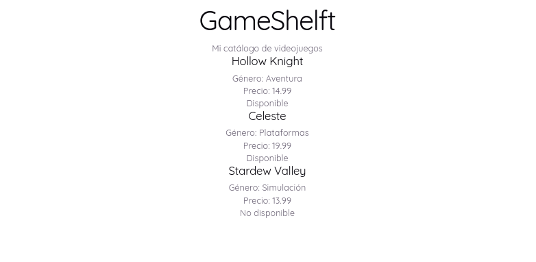
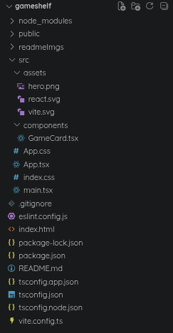
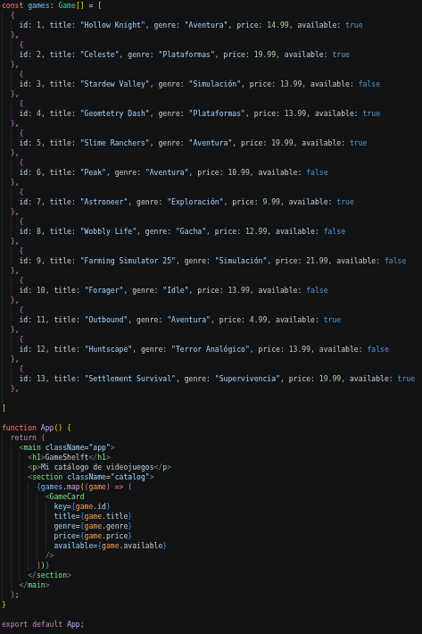
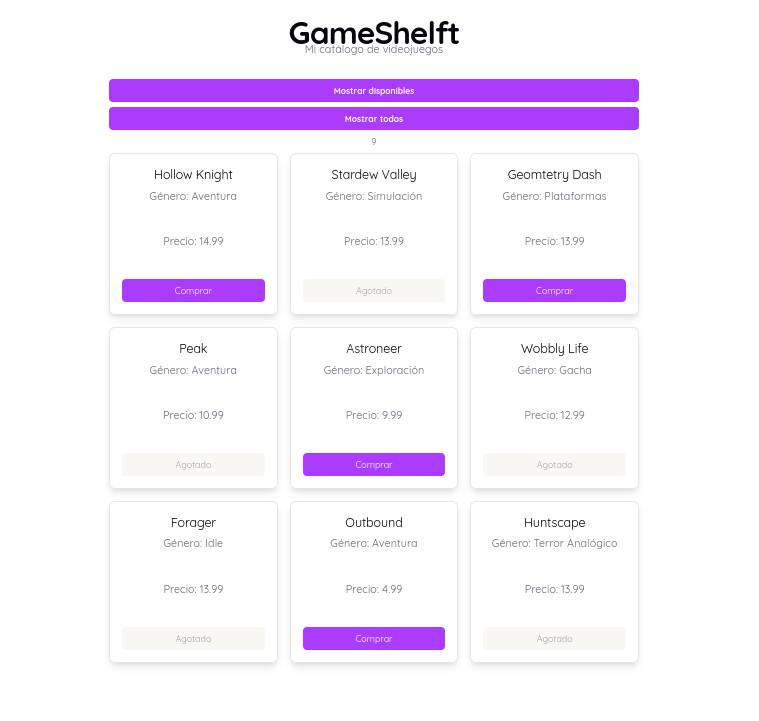
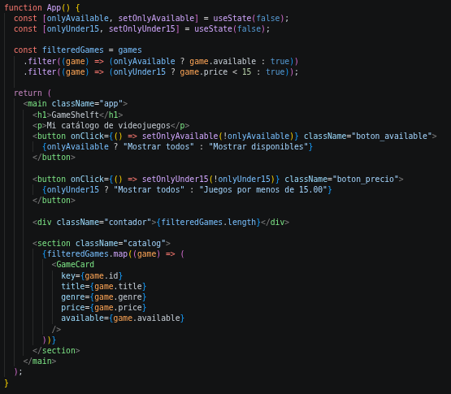

# Actividad 02: GameShelf, catálogo de videojuegos tipo Steam

**Autor:** Alejandro Donate García · 2º DAM · Programación multimedia y dispositivos móviles (UT2)
**Repositorio:** [alejandroDonGar/Programacion-multimedia-y-dispositivos-moviles-2026---2027](https://github.com/alejandroDonGar/Programacion-multimedia-y-dispositivos-moviles-2026---2027/tree/main/ut2-react-native/gameshelf) (carpeta `ut2-react-native/gameshelf`)

## Descripción

**GameShelf** es una página web hecha con **React + TypeScript** (proyecto creado con Vite) que muestra un catálogo de **13 videojuegos** en tarjetas. Cada tarjeta enseña el título, el género, el precio y un botón que dice *Comprar* si el juego está disponible o *Agotado* si no lo está. Hay dos filtros que se pueden combinar (solo disponibles y solo los de menos de 15 €) y un contador con los juegos que se están mostrando.



*Primera pantalla: título y los tres juegos de ejemplo, todavía sin estilos.*

## Herramientas usadas y cómo ejecutarlo

| Herramienta | Para qué se usa |
|-|-|
| Node.js y npm | Ejecutar JavaScript fuera del navegador e instalar las dependencias del proyecto |
| Vite | Servidor de desarrollo y compilación (`create-vite` con la plantilla `react-ts`) |
| React 19 | Biblioteca para construir la interfaz con componentes |
| TypeScript | Tipado estático de los datos (`Game`, `GameCardProps`) |
| Visual Studio Code | Editor |
| Git y GitHub | Control de versiones y entrega |

Pasos para crear el proyecto (los que se siguieron en clase):

```bash
node --version
npm --version
npm create vite@latest gameshelf -- --template react-ts
cd gameshelf
npm install
npm run dev
```

Para ejecutar el proyecto una vez clonado basta con `npm install` y `npm run dev`, y abrir `http://localhost:5173/`.

---

# Sesión 1 · Preparación e interfaz

## ¿Qué es 'React' y qué ocurre en el entorno?

**¿Qué es React? ¿Es un lenguaje, una biblioteca o una herramienta para crear proyectos?**

* **Es una biblioteca (o librería) de JavaScript** de código abierto especializada en el diseño y la creación de interfaces de usuario (UI).

* **No es un lenguaje ni una herramienta de construcción completa**, ya que se apoya en JavaScript/TypeScript y en empaquetadores como Vite para poder compilar y estructurar proyectos enteros.

**¿Qué diferencia hay entre create-vite y Vite? ¿Qué hace Vite mientras ejecutamos npm run dev? ¿Qué crees que hará npm run build?**

* **`create-vite` es un script iniciador** (plantilla) que se ejecuta una sola vez para estructurar las carpetas y archivos base de tu nuevo proyecto. Vite es el motor/herramienta de desarrollo que gestiona tu proyecto a partir de ahí.

* **Mientras ejecutas `npm run dev`, Vite levanta un servidor de desarrollo local ultra rápido** que lee los cambios de tu código en tiempo real y actualiza el navegador al instante (Hot Module Replacement) sin recargar toda la página.

* **`npm run build` compila, optimiza y empaqueta** todo tu código fuente (TypeScript, JSX, CSS) en archivos puros de JavaScript, HTML y CSS minificados dentro de una carpeta llamada `dist`, listos para ser subidos a un servidor de producción.

**¿Qué son Node.js y npm? ¿Para qué usamos npm create, npm install y npm run dev?**

* **Node.js es un entorno de ejecución de JavaScript en el servidor** (fuera del navegador) y npm es su gestor de paquetes por defecto, que permite descargar herramientas de terceros.

* **`npm create` descarga y ejecuta una herramienta de inicialización** (como `create-vite`) para hacer proyectos desde cero; **`npm install` lee tu archivo `package.json` e instala** todas las dependencias del proyecto en tu máquina; **`npm run dev` arranca el servidor local** para empezar a programar.

**¿Qué son las dependencias? ¿Por qué aparece node_modules?**

* **Las dependencias son librerías de código reutilizable hechas por otros desarrolladores** (como React o los linters) que tu proyecto necesita para poder funcionar.

* **`node_modules` es la carpeta física donde npm descarga y almacena** todos los archivos de esas dependencias.

**¿Qué añade TypeScript a JavaScript?**

* **Añade tipado estático estricto y detección de errores en tiempo de desarrollo.** Te obliga a definir qué tipo de datos (número, texto, booleano, objeto) acepta cada variable o función para evitar fallos antes de que el código llegue al navegador.

**¿Qué significan JSX y TSX?**

* **JSX (JavaScript XML) es una extensión de sintaxis** que permite escribir código similar a HTML directamente dentro de tus funciones de JavaScript. **TSX es exactamente lo mismo, pero habilitado para usar TypeScript** dentro del archivo.

## Investigación de los archivos del proyecto



*Estructura del proyecto en VS Code: `src/components/GameCard.tsx` es el único componente propio; `readmeImgs/` guarda las capturas de este README.*

### index.html

**¿Qué elemento tiene id="root"?**

* El **`<div>`** que tenemos dentro del **`index.html`** lleva el id **root** porque será el elemento raíz del proyecto, dentro del **`<body>`**.

### src/main.tsx

**¿Qué componente importa? ¿Dónde aparece createRoot?**

* Importa el componente **`App`** desde **`./App.tsx`**.

* **`createRoot` aparece justo al principio de la ejecución principal**: captura el elemento DOM con **`document.getElementById('root')`** para inicializar y renderizar ahí la aplicación.

### src/App.tsx

**¿Qué interfaz se muestra?** (en la plantilla original de Vite, antes de cambiarlo)

* **Muestra un catálogo de videojuegos llamado "GameShelf"**, compuesto por un título **`<h1>`**, un párrafo descriptivo y una sección de clase **`catalog`** que renderiza una lista dinámica de componentes **`<GameCard/>`** a partir de un array de objetos (**`games`**).

### src/App.css

**¿Qué reglas visuales aparecen?** (en la plantilla original de Vite)

* **Aparecen estilos específicos de componentes**, tales como **`.counter`** (con bordes animados al pasar el cursor), una animación/posición tridimensional en perspectiva para **`.hero`** (con subelementos **`.framework`** y **`.vite`**), y diseños de secciones específicas como **`#center`**, **`#next-steps`** y **`#docs`**. Todo esto lo sustituí por mis propias reglas (ver la Sesión 2).

### src/index.css

**¿En qué se diferencia de App.css?**

* **`index.css` define las reglas e inicializaciones globales de la aplicación**. Aquí se configuran variables CSS (**`:root`**) para temas claros/oscuros, las fuentes del sistema, los márgenes globales del **`body`** y el tamaño/comportamiento del contenedor principal **`#root`**. **`App.css`** se enfoca solo en estilos modulares o de componentes internos.

### package.json

**¿Qué comandos aparecen en scripts?**

* Aparecen **`"dev": "vite"`**, **`"build": "tsc -b && vite build"`**, **`"lint": "eslint ."`** y **`"preview": "vite preview"`**.

### tsconfig.json

**¿Qué indica "ts"? ¿Necesitas editarlo hoy?**

* Indica **TypeScript**. Es un lenguaje basado en JavaScript que añade reglas y ayudas visuales para no cometer errores al escribir el código.

* **No**, no hace falta tocarlo. Solo tendría que editarlo si quisiera cambiar la forma en que se organiza, compila o conecta el proyecto.

### vite.config.ts

**¿Qué nombre de herramienta aparece?**

* Aparece **`vite`**.

### public/ y src/assets/

**¿Qué recursos encuentras?**

* En estas dos carpetas están los recursos gráficos que usa la página, como favicons o imágenes `.png` y `.svg` (`hero.png`, `react.svg`, `vite.svg`).

### node_modules/

**¿Qué contiene? ¿Por qué no se sube?**

* Contiene los módulos y librerías externas que el proyecto necesita para funcionar y que se descargan de internet: **React**, **TypeScript**, **Vite**, etc.

* No se sube porque es **innecesario, ineficiente y una mala práctica**: por el **peso masivo** de todas las librerías, porque ya están registradas en **`package.json`**, por la incompatibilidad con otros sistemas y porque es fácilmente recreable por otros programadores con **`npm install`**.

### .gitignore

**¿Qué archivos o carpetas ignora Git?**

* El **`.gitignore`** evita que se suban a **GitHub** los archivos que no queremos en el repositorio (por ejemplo `node_modules`).

### Preguntas de la actividad sobre los archivos

* **¿Qué archivo contiene el punto de entrada HTML?** `index.html` (tiene el `<div id="root">`).
* **¿Qué archivo carga App?** `src/main.tsx`, que importa `App` y lo dibuja dentro de `#root` con `createRoot`.
* **¿Cuál es el componente principal?** `App`, en `src/App.tsx`.
* **¿Qué hace el script `dev`?** Ejecuta `vite`, que arranca el servidor local de desarrollo.
* **¿Qué significa la extensión `.tsx`?** Que es un archivo TypeScript que además contiene JSX.

## Glosario de conceptos

| Concepto | Funcionalidad |
|-|-|
| JavaScript | Lenguaje de programación base de la web que permite dar interactividad y lógica a las aplicaciones |
| TypeScript | Superconjunto de JavaScript que añade **tipado estático** para detectar errores en el código antes de ejecutarlo |
| JSX | Extensión de la sintaxis de JavaScript que permite escribir estructuras similares a **HTML directamente dentro de código JS** |
| TSX | Es exactamente lo mismo que JSX, pero adaptado para trabajar bajo las reglas y el **soporte de tipos de TypeScript** |
| Componente | Bloque de código **reutilizable e independiente** (normalmente una función) que define una parte de la interfaz de usuario |
| Props | Argumentos u objetos que se pasan a un componente desde el exterior para **configurarlo o enviarle datos** |
| Función | Bloque de código diseñado para realizar una tarea específica cuando es invocado o llamado |
| Parámetro | La **variable o hueco** que se define en la declaración de una función para recibir los datos de entrada |
| Evento | Una acción o suceso detectado por el navegador provocado por el usuario (como hacer **`click`**, escribir o hacer scroll) |
| Manejador | (Handler) La **función específica que se ejecuta** como respuesta inmediata cuando ocurre un evento determinado |
| Estado | Memoria interna de un componente que **guarda datos que pueden cambiar** y que, al modificarse, obligan a redibujar la pantalla |
| Callback | Una **función que se pasa a otra función como argumento** para ser ejecutada más tarde (normalmente al terminar una tarea) |

---

# Sesión 2 · Componentes, catálogo y estilos

## Cambio de la pantalla inicial

Se borró el ejemplo de Vite de `src/App.tsx` y se dejó un componente `App` que solo devuelve un `<main className="app">` con un `<h1>` y un `<p>`. Un **componente** es una función que devuelve la interfaz (JSX); `App` pasó a mostrar el título y "Mi catálogo de videojuegos". El `import "./App.css"` carga los estilos y el `export default` permite que `main.tsx` lo use.

## Componente `GameCard` y props

En `src/components/GameCard.tsx` se creó la tarjeta de un videojuego:

* Recibe **props** (`title`, `genre`, `price`, `available`) desde `App`. El tipo `GameCardProps` describe sus nombres y tipos, de modo que TypeScript avisa si falta una o es de otro tipo.
* Las **llaves `{}`** dentro del JSX insertan expresiones de JavaScript.
* Usa un **ternario** para el botón: si `available` es `true` pone la clase `available` y el texto *Comprar*; si no, la clase `unavailable` y el texto *Agotado*.

## Datos y `map()`

En `App.tsx` se declara el tipo `Game` y el array `games: Game[]`. `Game[]` significa "array de elementos `Game`"; `string` es texto, `number` es número y `boolean` es `true`/`false`.

```tsx
{filteredGames.map((game) => (
  <GameCard key={game.id} title={game.title} genre={game.genre}
            price={game.price} available={game.available} />
))}
```

* **`map()`** es un método de los arrays que recorre la lista y transforma cada juego en un componente `GameCard`.
* **`(game) => (...)`** es una **función flecha**: `map` la ejecuta una vez por elemento. **`game`** es su **parámetro** y en cada vuelta contiene un videojuego distinto. La función **devuelve** el `GameCard` que se añade a la lista.
* **`key`** da a React una identificación estable para reconocer cada tarjeta cuando cambia la lista (por ejemplo, al filtrar) y redibujar solo lo necesario. No es una prop normal de `GameCard`: la usa React internamente.
* **Función:** un bloque de instrucciones que se puede reutilizar. **Definirla** (`function saludar() {...}`) solo la declara; **llamarla** (`saludar()`) es lo que la ejecuta.

## Ampliación del catálogo

Se conservaron los tres juegos de ejemplo (Hollow Knight, Celeste y Stardew Valley) y se añadieron **diez más hasta llegar a 13**: Geometry Dash, Slime Ranchers, Peak, Astroneer, Wobbly Life, Farming Simulator 25, Forager, Outbound, Huntscape y Settlement Survival. Cada objeto lleva un `id` numérico único, título, género, precio (número sin comillas) y disponibilidad, mezclando precios por debajo y por encima de 15 € y juegos disponibles y agotados para poder probar bien los filtros.



*Array `games` con los 13 videojuegos y el `map()` que los pinta.*

## Estilos CSS

### ¿Qué es CSS?
**CSS (Cascading Style Sheets)** o Hojas de Estilo en Cascada es el lenguaje utilizado para describir la presentación, el formato y el diseño visual de los elementos de una página web. Separar el contenido (TSX/HTML) del diseño (CSS) permite mantener un código limpio y escalable.

### ¿Qué es un selector CSS?
Un **selector** es el patrón que se escribe en el archivo CSS para decirle al navegador **a qué elementos queremos aplicar los estilos**. Por ejemplo:
* Un selector de etiqueta (`main`, `h1`) apunta a todos los elementos con esa etiqueta.
* Un selector de clase (`.catalog`, `.card`) apunta a los elementos que tengan asignada esa clase.

### ¿Qué es una propiedad CSS?
Una **propiedad** es la característica concreta del elemento que queremos modificar (color, tamaño, margen, distribución...). Cada propiedad lleva un **valor**: en `color: red;`, `color` es la propiedad y `red` el valor.

### ¿Dónde escribí los estilos?
En **`src/App.css`**, que contiene CSS normal, sin TypeScript ni JSX. Los colores y la tipografía generales se toman de las variables definidas en `src/index.css`.

### ¿Cómo conecté una clase del TSX con su regla CSS?
1. **Importación:** `src/App.tsx` incluye `import './App.css'`, lo que hace que Vite cargue esos estilos en la aplicación.
2. **Nombres:** en el **TSX** los elementos reciben su identificador con el atributo **`className`** (por ejemplo `className="catalog"`). Se usa `className` y no `class` porque `class` es una palabra reservada de JavaScript. En el **CSS** se escribe el mismo nombre precedido de un **punto** (`.catalog`); el navegador entiende que es una clase y aplica esas propiedades al elemento.

### Reglas CSS que creé (todas en `src/App.css`)

| Selector | Para qué sirve |
|-|-|
| `.app` | Centra la página con un ancho máximo de 1100 px y un `padding` |
| `.app h1`, `.app p` | Tamaño, color y márgenes del título y del subtítulo |
| `.catalog` | **CSS Grid**: `repeat(auto-fill, minmax(280px, 1fr))` crea una cuadrícula responsiva, sin *media queries*: las columnas se reparten solas según el ancho de la pantalla |
| `.card` | **Flexbox** vertical (`flex-direction: column`) para alinear título, género, precio y botón; borde redondeado, sombra y `transition` |
| `.card:hover` | Sube la tarjeta 4 px (`translateY(-4px)`) y cambia el borde al pasar el ratón |
| `.card h2` | Tamaño y color del título de la tarjeta |
| `.card button`, `.card button.available`, `.card button.unavailable` | Botón de compra: morado si hay stock; gris, con opacidad y cursor `not-allowed` si está agotado |
| `.boton_available`, `.boton_precio` | Botones de filtro: ancho completo, `:hover` con brillo y sombra, `:active` que los encoge un poco y `:focus-visible` con contorno para teclado |
| `.contador`, `.subtitulo` | Espaciado del contador de juegos mostrados y del subtítulo |

* **Variables CSS (`var(--...)`):** los colores (`--accent`, `--border`, `--text`...), la sombra y la fuente se definen una sola vez en `:root` (`index.css`) y se reutilizan, así que cambiar el color de acento cambia todo el diseño.



*Diseño con estilos: cuadrícula de tarjetas, botones de filtro y contador.*

---

# Sesión 3 · Interactividad

## Estado, eventos y manejadores

* **Estado vs. variable normal:** una variable normal puede cambiar, pero React no vuelve a dibujar la pantalla por ello. El **estado** (`useState`) sí: al cambiarlo, React **vuelve a renderizar** el componente con el valor nuevo.
* **`useState`** es un *hook* que devuelve el **valor actual** y una **función para cambiarlo**: `const [onlyAvailable, setOnlyAvailable] = useState(false);` (valor inicial `false`; la sintaxis de corchetes es desestructuración).
* **Evento:** una acción del usuario, como un clic. **Manejador:** la función que responde. **`onClick`** es la prop de React que escucha el clic.
* **Pasar una función vs. llamarla:** `onClick={() => setOnlyAvailable(!onlyAvailable)}` entrega una función flecha que se ejecutará **cuando ocurra el clic**. Si se escribiera `onClick={setOnlyAvailable(!onlyAvailable)}` se llamaría durante el renderizado, no al pulsar. El `!` invierte el valor (`false` ↔ `true`).
* **Callback:** una función que se pasa a otra para que la ejecute más tarde; la función flecha de `onClick` y la de `filter()`/`map()` son callbacks.

## Filtros

```tsx
const [onlyAvailable, setOnlyAvailable] = useState(false);
const [onlyUnder15, setOnlyUnder15] = useState(false);

const filteredGames = games
  .filter((game) => (onlyAvailable ? game.available : true))
  .filter((game) => (onlyUnder15 ? game.price < 15 : true));
```

* **`filter()`** crea una lista nueva con los elementos para los que la función devuelve `true`; **no modifica el array original** `games`.
* **Filtro de disponibilidad:** si `onlyAvailable` es `true`, solo pasan los juegos con `available`; si es `false`, pasan todos. El botón cambia su texto con un ternario (*Mostrar disponibles* / *Mostrar todos*).
* **Filtro de precio (reto):** segundo estado `onlyUnder15`. La condición `game.price < 15` se aplica **sobre la lista que ya salió del primer filtro**, por eso los dos filtros se combinan. Si el segundo partiera de `games`, el de disponibilidad se perdería.
* **Contador (extra):** un `<div className="contador">` muestra `filteredGames.length`, es decir, cuántos juegos se están viendo.

El `map()` pinta `filteredGames`, así que cualquier cambio de estado actualiza las tarjetas.



*Código de los dos filtros encadenados, los botones y el contador.*

## Cómo probé los filtros

Con los 13 juegos del catálogo, el resultado esperado de cada combinación es:

| Filtros activados | Juegos mostrados |
|-|-|
| Ninguno | 13 |
| Disponibles | 7 (Hollow Knight, Celeste, Geometry Dash, Slime Ranchers, Astroneer, Outbound, Settlement Survival) |
| Menos de 15 € | 9 (Hollow Knight, Stardew Valley, Geometry Dash, Peak, Astroneer, Wobbly Life, Forager, Outbound, Huntscape) |
| Disponibles y menos de 15 € | 4 (Hollow Knight, Geometry Dash, Astroneer, Outbound) |

La captura final de arriba corresponde al filtro de precio activo: el contador marca **9** y el botón de disponibilidad sigue en "Mostrar disponibles".

> 📸 *Pendiente:* captura con el **filtro de disponibilidad activo** (y otra con los dos filtros combinados, que deberían dar 4 juegos); guardarla en `readmeImgs/` y enlazarla aquí.

---

# Reflexión final

1. **¿Qué archivo conecta el HTML con App?** `src/main.tsx`: importa `App` y lo renderiza dentro del `<div id="root">` de `index.html` con `createRoot`.
2. **¿Qué diferencias hay entre React, TypeScript y Vite?** React es la biblioteca que construye la interfaz con componentes; TypeScript es el lenguaje (JavaScript con tipos) en el que está escrito el código; Vite es la herramienta que sirve el proyecto en desarrollo y lo compila para publicarlo.
3. **¿Qué son las props de GameCard?** Los datos que recibe desde `App` (`title`, `genre`, `price`, `available`) para saber qué mostrar; `GameCardProps` define sus tipos.
4. **¿Por qué usamos `setOnlyAvailable` para cambiar el estado?** Porque es la forma de avisar a React de que el valor cambió; así vuelve a renderizar. Si se modificara la variable directamente, la pantalla no se actualizaría.
5. **¿Qué hacen `map()` y `filter()`?** `map()` transforma cada elemento de una lista en otra cosa (aquí, un juego en una tarjeta); `filter()` crea una lista nueva solo con los elementos que cumplen una condición.
6. **¿Para qué sirve `key`?** Para que React identifique cada tarjeta de forma estable y sepa cuáles cambian, se añaden o se quitan al filtrar.
7. **¿Qué error te costó más resolver y cómo lo solucionaste?** Ver el apartado *Dificultades y soluciones*.

# Fuentes consultadas

* [Guía de inicio de Vite](https://vite.dev/guide/)
* [Aprender React](https://react.dev/learn)
* [Tu primer componente](https://react.dev/learn/your-first-component)
* [Estado: la memoria de un componente](https://react.dev/learn/state-a-components-memory)
* [Mostrar listas en React](https://react.dev/learn/rendering-lists)
* [Añadir código local a GitHub](https://docs.github.com/es/migrations/importing-source-code/using-the-command-line-to-import-source-code/adding-locally-hosted-code-to-github)
