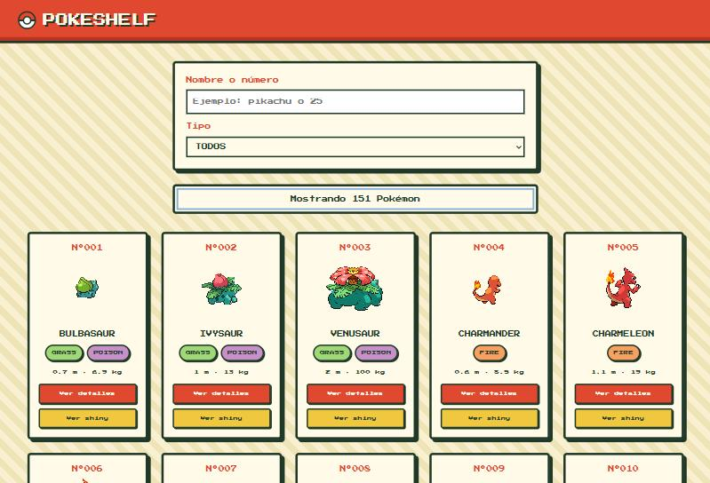
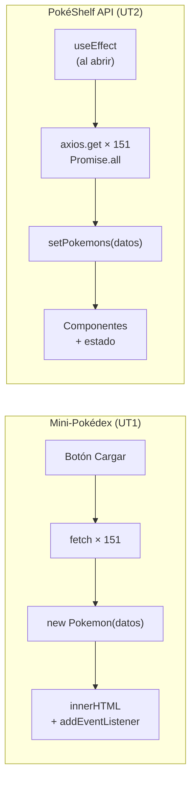
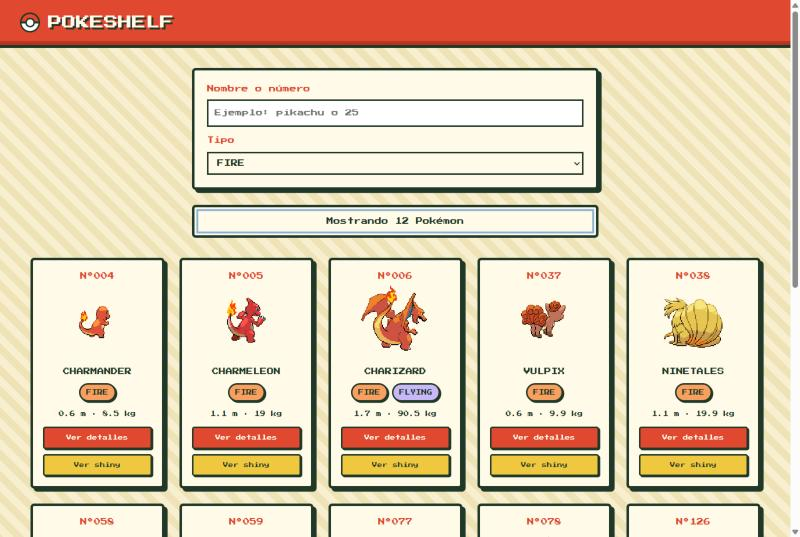
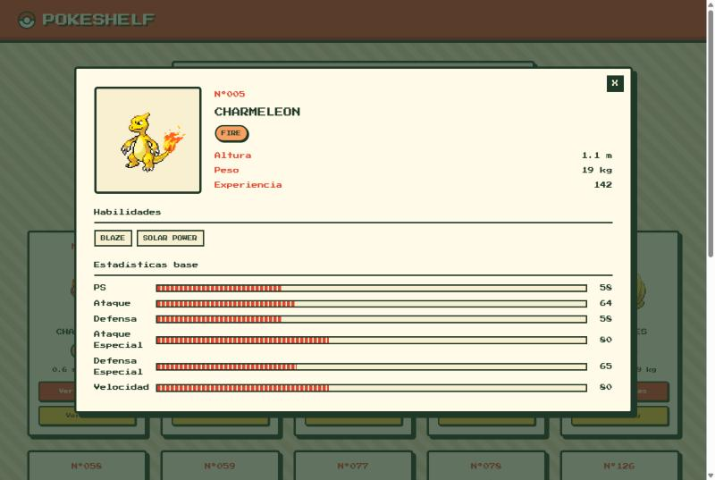
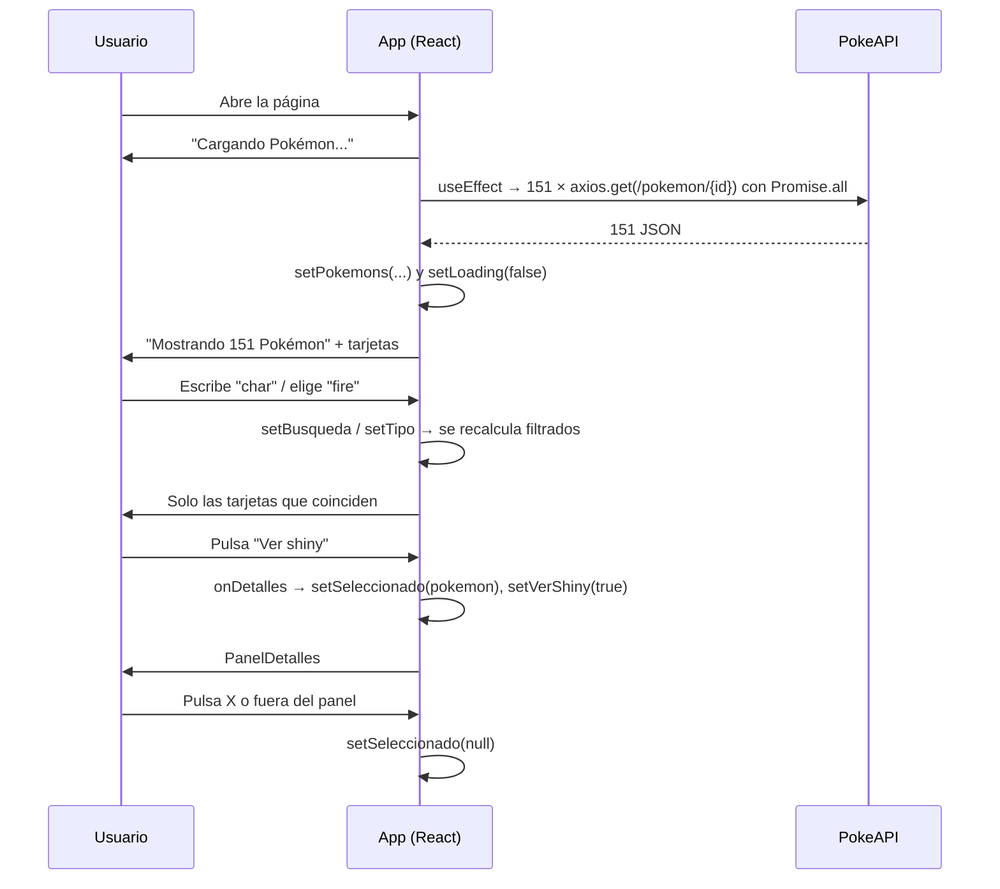

# Actividad 04: PokéShelf API, la mini-Pokédex rehecha en React con axios

**Autor:** Alejandro Donate García · 2º DAM · Programación multimedia y dispositivos móviles (UT2)
**Repositorio:** [alejandroDonGar/Programacion-multimedia-y-dispositivos-moviles-2026---2027](https://github.com/alejandroDonGar/Programacion-multimedia-y-dispositivos-moviles-2026---2027/tree/main/ut2-react-native/pokeshelfAPI) (carpeta `ut2-react-native/pokeshelfAPI`)
**Proyectos de partida:**
* [`mini-pokédex`](../../ut1-fundamentos/octubre/mini-pokédex/README.md) (UT1): la Pokédex en JavaScript puro con `fetch`, DOM e `innerHTML`.
* [`gameshelfAPI`](../gameshelfAPI/README.md) (UT2): el sistema nuevo de conexión a una API con React, axios y un tipo que copia el JSON.

## Descripción

**PokéShelf API** aplica a la **PokeAPI** lo que se hizo en GameShelf API: la mini-Pokédex de la UT1 se reconstruye en **React + TypeScript** (Vite) y los Pokémon se piden con **axios**, sin crear los objetos a mano.

* **API usada:** [`https://pokeapi.co/api/v2/pokemon/{id}`](https://pokeapi.co/api/v2/pokemon/25), una petición por cada uno de los **151 Pokémon** de la primera generación.
* **Tarjeta:** número (`Nº025`), sprite **de espaldas que se gira de frente** al pasar el ratón, nombre, tipos con su color, altura y peso, y los botones *Ver detalles* y *Ver shiny*.
* **Buscador:** por nombre (o parte de él) o por número, en tiempo real mientras se escribe.
* **Filtro por tipo:** un desplegable con los 17 tipos que aparecen entre los 151, combinable con el buscador.
* **Panel de detalles:** sprite normal o shiny, altura, peso, experiencia base, habilidades y estadísticas base con barras animadas. Se cierra con la **X** o pulsando fuera.
* **Mensajes:** "Cargando Pokémon...", error de conexión, "Mostrando N Pokémon" o "No hay ningún Pokémon que coincida".
* **Estilo:** el mismo estilo retro de la mini-Pokédex (fuente *Press Start 2P*, papel a rayas, sombras duras y colores por tipo).



*Al abrir la página se cargan los 151 Pokémon sin pulsar ningún botón.*

## Herramientas usadas y cómo ejecutarlo

| Herramienta | Para qué se usa |
|-|-|
| Node.js y npm | Ejecutar JavaScript fuera del navegador e instalar las dependencias |
| Vite 8 | Servidor de desarrollo y compilación (`create-vite` con la plantilla `react-ts`) |
| React 19 | Interfaz con componentes y estado |
| TypeScript 6 | Tipado estático: el tipo `Pokemon` describe el JSON de la PokeAPI |
| axios | Peticiones HTTP a la PokeAPI |
| PokeAPI | Fuente de los datos de los Pokémon |

Creación del proyecto:

```bash
npm create vite@latest pokeshelf -- --template react-ts
cd pokeshelf
npm install
npm install axios
npm run dev
```

Para ejecutarlo una vez clonado: `npm install` y `npm run dev`, y abrir la URL que imprime Vite (normalmente `http://localhost:5173/`).

> La carpeta se creó como `pokeshelf` y luego se renombró a `pokeshelfAPI` (commit `4ff3701`). El nombre interno de `package.json` es `pokeshelfapi`, en minúsculas, porque npm no admite mayúsculas en ese campo.

---

# De la mini-Pokédex a PokéShelf API: qué ha cambiado

| | Mini-Pokédex (UT1, JavaScript + DOM) | PokéShelf API (UT2, React + axios) |
|-|-|-|
| **Petición** | `fetch` + comprobar `respuesta.ok` + `.json()` | `axios.get<Pokemon>` (convierte el JSON y lanza los errores solo) |
| **Cómo se crean los objetos** | Clase `Pokemon.js`: `new Pokemon(datos)` copia campo a campo y traduce los nombres | Tipo `Pokemon` con la misma forma que el JSON: axios entrega el objeto ya hecho |
| **Cuándo se cargan** | Al pulsar el botón "Cargar Pokémon" | Solos al abrir la página (`useEffect`) |
| **Lista de Pokémon** | Variable global `let listaPokemon = []` | Estado `pokemons` (`useState`) |
| **Buscador y filtro** | Se lee el DOM: `inputBusqueda.value`, `selectorTipo.value` | Estados `busqueda` y `tipo` (inputs controlados) |
| **Pintar las tarjetas** | Plantillas de texto con `innerHTML` | Componentes `PokemonCard`, `TiposPokemon` y `PanelDetalles` |
| **Selector de tipos** | `rellenarSelectorTipos()` con `forEach` + `includes` | `new Set` + `flatMap` y un `map` a `<option>` |
| **Girar el sprite** | `addEventListener("mouseenter")` sobre cada tarjeta | `onMouseEnter` + estado `deFrente` en cada tarjeta |
| **Saber qué botón se pulsó** | `data-id`, `data-shiny`, `closest()` y `find()` | Cada botón llama a `onDetalles(pokemon, shiny)` con su propio Pokémon |
| **Panel de detalles** | `<dialog>` + `showModal()` / `close()` | `{seleccionado && <PanelDetalles />}` |
| **Altura y peso** | Ya divididos entre 10 en el constructor | Se dividen entre 10 al mostrarlos |



## Estructura del proyecto

```
src/
├── types/Pokemon.ts            ← forma del JSON de la PokeAPI
├── utils.ts                    ← formatearId y nombres de las estadísticas
├── components/
│   ├── TiposPokemon.tsx        ← etiquetas de tipo (las usan la tarjeta y el panel)
│   ├── PokemonCard.tsx         ← una tarjeta
│   └── PanelDetalles.tsx       ← ventana de detalles
├── App.tsx                     ← petición, estados, filtros y página
├── App.css                     ← el style.css de la mini-Pokédex adaptado
└── index.css                   ← vacío (quitaba el tema de Vite)
```

## 1. Antes: la clase `Pokemon.js` construía cada objeto

En la mini-Pokédex, cada respuesta de la API pasaba por una clase que **copiaba los datos uno a uno** a un objeto nuevo, traduciendo los nombres y transformando los valores:

```js
class Pokemon {
    constructor(datos) {
        this.id = datos.id;
        this.nombre = datos.name;
        this.spriteFrente = datos.sprites.front_default;
        this.spriteEspalda = datos.sprites.back_default;
        this.spriteShiny = datos.sprites.front_shiny;
        this.altura = datos.height / 10;
        this.peso = datos.weight / 10;
        this.tipos = datos.types.map(({ type }) => type.name);
        this.experiencia = datos.base_experience;
        this.habilidades = datos.abilities.map(({ ability }) => ability.name);
        this.stats = datos.stats.map(({ stat, base_stat }) => ({ nombre: stat.name, valor: base_stat}));
    }
}
```

```js
const datos = await respuesta.json();
return new Pokemon(datos);
```

Funcionaba, pero cada campo nuevo obligaba a tocar el constructor, y el objeto final no tenía la misma forma que el JSON: había que recordar que `name` pasaba a llamarse `nombre`, que `types` pasaba a ser un array de textos, etc.

## 2. Ahora: un tipo con la misma forma que el JSON

Igual que el tipo `Game` de GameShelf API: se abre en el navegador una URL de la API (por ejemplo [`/pokemon/25`](https://pokeapi.co/api/v2/pokemon/25)), se mira el JSON y se escribe un tipo con **los mismos nombres y la misma estructura**:

```ts
// Estructura del JSON que devuelve https://pokeapi.co/api/v2/pokemon/{id}.
// Igual que en gameshelfAPI: el tipo copia los nombres de la API (name, base_experience...)
// y así axios nos da el objeto ya hecho, sin necesitar la clase Pokemon.js de la mini-Pokédex.
// Solo declaramos los campos que usamos; la API manda muchos más y TypeScript los ignora.
export type Pokemon = {
    id: number;
    name: string;
    height: number;
    weight: number;
    base_experience: number;
    sprites: {
        front_default: string;
        back_default: string;
        front_shiny: string;
    };
    types: { type: { name: string } }[];
    abilities: { ability: { name: string } }[];
    stats: { base_stat: number; stat: { name: string } }[];
};
```

Fragmento real del JSON de Pikachu, para comparar (la API manda mucho más):

```json
{
  "id": 25,
  "name": "pikachu",
  "height": 4,
  "weight": 60,
  "base_experience": 112,
  "types": [{ "slot": 1, "type": { "name": "electric", "url": "https://pokeapi.co/api/v2/type/13/" } }],
  "stats": [{ "base_stat": 35, "effort": 0, "stat": { "name": "hp", "url": "..." } }]
}
```

* **`{ type: { name: string } }[]`**: un array (`[]`) de objetos, cada uno con un objeto `type` dentro que tiene `name`. Es exactamente la forma de `types` en el JSON.
* **Solo se declaran los campos que se usan.** El JSON de un Pokémon tiene cientos de líneas (movimientos, juegos en los que aparece, `slot`, `url`...). Lo que no se declara, TypeScript lo ignora.
* **Ya no hay constructor:** `axios.get<Pokemon>(url)` devuelve en `respuesta.data` un objeto con esa forma, listo para usar. Las transformaciones que hacía la clase (dividir entre 10, quedarse con el nombre del tipo) se hacen ahora **al mostrar** los datos.

> **Ojo:** el tipo es una promesa que se le hace a TypeScript, no una comprobación. Si se escribe mal un nombre (por ejemplo `base_exp`), el código compila pero el dato sale `undefined`. Es lo que pasó con `Japon`/`Japan` en GameShelf API.

## 3. La carga: `useEffect`, `Promise.all` y axios

```tsx
const API_URL = "https://pokeapi.co/api/v2/pokemon";
const TOTAL_POKEMON = 151;

useEffect(() => {
  async function loadPokemons() {
    try {
      const ids = Array.from({ length: TOTAL_POKEMON }, (_, i) => i + 1);
      const respuestas = await Promise.all(
        ids.map((id) => axios.get<Pokemon>(`${API_URL}/${id}`))
      );
      setPokemons(respuestas.map((respuesta) => respuesta.data));
    } catch (error) {
      console.error(error);
      setError("No se pudo conectar con la PokéAPI");
    } finally {
      setLoading(false);
    }
  }
  loadPokemons();
}, []);
```

* **Diferencia con GameShelf API:** la API de juegos devolvía **todo el catálogo en una sola respuesta**. La PokeAPI no: el detalle de cada Pokémon está en su propia URL (`/pokemon/1`, `/pokemon/2`...), así que hacen falta **151 peticiones**.
* **`Array.from({ length: 151 }, (_, i) => i + 1)`**: crea `[1, 2, 3, ..., 151]`. Sustituye al bucle `for` que rellenaba el array `ids` en la mini-Pokédex. El `_` es el primer parámetro (el valor, que no se usa) e `i` es la posición.
* **`ids.map((id) => axios.get(...))`**: convierte cada número en una **promesa** (una petición que todavía no ha terminado).
* **`Promise.all(promesas)`**: lanza las 151 peticiones **a la vez** y espera a que terminen todas. Devuelve las respuestas **en el mismo orden** que los ids, así que salen ordenados del 1 al 151. Si una sola falla, `Promise.all` falla entero y se salta al `catch`.
* **`respuestas.map((respuesta) => respuesta.data)`**: se queda con el objeto `Pokemon` de cada respuesta.
* **`useEffect(..., [])`**: la carga se hace una sola vez al abrir la página. Por eso ya no hace falta el botón "Cargar Pokémon".
* **`finally`**: quita el "Cargando..." tanto si ha ido bien como si ha fallado.

La misma idea con `fetch` en la mini-Pokédex necesitaba comprobar `respuesta.ok` y lanzar el error a mano, y convertir con `.json()`. axios hace las dos cosas solo.

## 4. Estado en lugar de variables globales y DOM

```tsx
const [pokemons, setPokemons] = useState<Pokemon[]>([]);
const [loading, setLoading] = useState(true);
const [error, setError] = useState<string | null>(null);
const [busqueda, setBusqueda] = useState("");
const [tipo, setTipo] = useState("todos");
const [seleccionado, setSeleccionado] = useState<Pokemon | null>(null);
const [verShiny, setVerShiny] = useState(false);
```

| Estado | Sustituye a (mini-Pokédex) | Para qué sirve |
|-|-|-|
| `pokemons` | `let listaPokemon = []` | Los 151 Pokémon descargados |
| `loading` / `error` | `mensaje.textContent = "Cargando..."` | Qué mensaje enseñar |
| `busqueda` | `inputBusqueda.value` | Texto del buscador |
| `tipo` | `selectorTipo.value` | Tipo elegido en el desplegable |
| `seleccionado` | `listaPokemon.find(...)` + `panel.showModal()` | Pokémon abierto en el panel (`null` = cerrado) |
| `verShiny` | `boton.hasAttribute("data-shiny")` | Si el panel enseña el sprite shiny |

**La diferencia clave:** en la mini-Pokédex, cada vez que cambiaba algo había que **volver a pintar a mano** (`mostrarTarjeta(filtrado)`, `mensaje.textContent = ...`). En React basta con cambiar el estado: React vuelve a ejecutar `App` y actualiza solo lo que ha cambiado.

## 5. Buscador y filtro por tipo

### Inputs controlados

```tsx
<input
  id="busqueda"
  type="text"
  placeholder="Ejemplo: pikachu o 25"
  autoComplete="off"
  value={busqueda}
  onChange={(evento) => setBusqueda(evento.target.value)}
/>
```

* **`value={busqueda}`**: el texto que se ve sale del estado.
* **`onChange`**: en cada tecla se guarda el texto nuevo en el estado. Equivale al `addEventListener("input", filtrarPokemon)` de la mini-Pokédex, sin tener que llamar a ninguna función de pintar.
* A esto se le llama **input controlado**: React es quien manda sobre su valor. El `<select>` del tipo funciona igual con `value={tipo}` y `setTipo`.
* Como se filtra mientras se escribe, ya no hace falta el botón "Buscar" ni el `preventDefault()` del formulario.

### Lista de tipos sin repetir

```tsx
const tipos = [...new Set(pokemons.flatMap((p) => p.types.map((t) => t.type.name)))].sort();
```

Se lee de dentro hacia fuera:

1. **`p.types.map((t) => t.type.name)`**: de un Pokémon saca sus tipos como textos: `["grass", "poison"]`.
2. **`flatMap`**: hace eso con todos y **aplana** el resultado en un solo array: `["grass", "poison", "grass", "poison", "fire", ...]`. Con `map` saldría un array de arrays.
3. **`new Set(...)`**: un `Set` es una colección que **no admite repetidos**, así que quita los duplicados.
4. **`[...set]`**: el operador *spread* (`...`) vuelve a convertir el `Set` en array para poder usar `.sort()` y `.map()`.

Sustituye a los dos `forEach` con `includes` de `rellenarSelectorTipos()`. Las opciones se pintan con `map`, como las tarjetas:

```tsx
<option value="todos">Todos</option>
{tipos.map((t) => (
  <option key={t} value={t}>{t}</option>
))}
```

### Filtrado encadenado

```tsx
const texto = busqueda.toLowerCase().trim();
const filtrados = pokemons
  .filter((p) => p.name.includes(texto) || Number(texto) === p.id)
  .filter((p) => tipo === "todos" || p.types.some((t) => t.type.name === tipo));
```

* Es la misma técnica que los filtros de GameShelf: el segundo `filter` trabaja sobre lo que dejó el primero, así que **los dos filtros se combinan**.
* **`p.name.includes(texto)`**: busca por parte del nombre (`"char"` encuentra Charmander, Charmeleon y Charizard). Con el texto vacío, `includes("")` es siempre `true` y pasan todos.
* **`Number(texto) === p.id`**: busca por número.
* **`some()`**: devuelve `true` si **al menos uno** de los tipos del Pokémon coincide con el elegido.
* `filtrados` no es un estado: es un valor **calculado** a partir de los estados. Se recalcula solo en cada renderizado.



*Con el tipo `fire` elegido quedan 12 Pokémon.*

## 6. Los componentes

### `TiposPokemon`: un componente reutilizable

```tsx
import type { Pokemon } from "../types/Pokemon";

type TiposPokemonProps = {
    tipos: Pokemon["types"];
};

export default function TiposPokemon({ tipos }: TiposPokemonProps) {
    return (
        <div className="tarjeta__tipos">
            {tipos.map(({ type }) => (
                <span key={type.name} className={`tipo tipo--${type.name}`}>
                    {type.name}
                </span>
            ))}
        </div>
    );
}
```

* Sustituye a la función `crearTiposHTML()`. Lo usan la tarjeta **y** el panel, así que se escribe una sola vez.
* **`Pokemon["types"]`**: "el tipo que tenga el campo `types` de `Pokemon`". Así no se repite `{ type: { name: string } }[]`, y si cambia en `Pokemon.ts`, cambia aquí también.
* **`({ type })`**: desestructuración en el parámetro, igual que en la mini-Pokédex.
* **`` className={`tipo tipo--${type.name}`} ``**: una plantilla de texto para que cada tipo tenga su clase de color (`tipo--fire`, `tipo--water`...).

### `PokemonCard`: estado propio y una función que llega por props

```tsx
type PokemonCardProps = {
    pokemon: Pokemon;
    onDetalles: (pokemon: Pokemon, shiny: boolean) => void;
};

export default function PokemonCard({ pokemon, onDetalles }: PokemonCardProps) {
    const [deFrente, setDeFrente] = useState(false);

    return (
        <article
            className="tarjeta"
            onMouseEnter={() => setDeFrente(true)}
            onMouseLeave={() => setDeFrente(false)}
        >
            <p className="tarjeta__numero">Nº{formatearId(pokemon.id)}</p>
            
            <h2 className="tarjeta__nombre">{pokemon.name}</h2>
            <TiposPokemon tipos={pokemon.types} />
            <p className="tarjeta__medidas">
                {pokemon.height / 10} m · {pokemon.weight / 10} kg
            </p>
            <button className="tarjeta__boton" type="button" onClick={() => onDetalles(pokemon, false)}>
                Ver detalles
            </button>
            <button className="tarjeta__boton tarjeta__boton--shiny" type="button" onClick={() => onDetalles(pokemon, true)}>
                Ver shiny
            </button>
        </article>
    );
}
```

* **Estado local `deFrente`**: cada tarjeta tiene **su propio** estado. Al entrar el ratón se pone a `true` y el `src` cambia al sprite de frente. Sustituye a `activarCambioSprite()`, que buscaba todas las tarjetas y les añadía dos `addEventListener` a cada una, y a los atributos `data-frente`/`data-espalda`.
* **`onDetalles`**: una **función que se pasa como prop** (un *callback*). La tarjeta no sabe nada del panel: solo avisa a `App` de qué Pokémon se ha pulsado y si es shiny. Es la forma de que un componente hijo comunique algo al padre.
* **`(pokemon: Pokemon, shiny: boolean) => void`**: el tipo de esa función. Recibe un Pokémon y un booleano y no devuelve nada (`void`).
* En la mini-Pokédex había **un solo** `addEventListener("click")` en el contenedor que, con `closest()`, `data-id` y `find()`, averiguaba qué tarjeta y qué botón se habían pulsado. Ahora cada botón ya sabe su Pokémon.
* **`height / 10`** y **`weight / 10`**: la PokeAPI da la altura en decímetros y el peso en hectogramos. Antes lo hacía el constructor; ahora se hace al pintar.

`formatearId` está en `utils.ts`, porque la usan la tarjeta y el panel:

```ts
export const formatearId = (id: number) => String(id).padStart(3, "0");
```

### `PanelDetalles` y cómo se abre

En `App`:

```tsx
function abrirDetalles(pokemon: Pokemon, shiny: boolean) {
  setSeleccionado(pokemon);
  setVerShiny(shiny);
}
```

```tsx
{seleccionado && (
  <PanelDetalles
    pokemon={seleccionado}
    shiny={verShiny}
    onCerrar={() => setSeleccionado(null)}
  />
)}
```

* **Abrir** el panel = guardar el Pokémon en `seleccionado`. **Cerrar** = volver a ponerlo a `null`. Con `seleccionado && ...` el panel solo existe mientras hay uno elegido.
* Sustituye a `panel.showModal()` y `panel.close()` del `<dialog>`.

Dentro del panel:

```tsx
<div className="fondo" onClick={onCerrar}>
    <div
        className="panel"
        role="dialog"
        aria-modal="true"
        aria-label={`Detalles de ${pokemon.name}`}
        onClick={(evento) => evento.stopPropagation()}
    >
        {/* ... */}
    </div>
</div>
```

* **`.fondo`**: una capa oscura que cubre toda la pantalla. Al pulsar en ella se cierra el panel.
* **`stopPropagation()`**: los clics "suben" de un elemento a sus padres (*propagación*). Sin esta línea, pulsar **dentro** del panel también llegaría al fondo y lo cerraría.
* **`role="dialog"` y `aria-modal`**: indican a los lectores de pantalla que es una ventana, como hacía `<dialog>` por sí solo.

Las barras de estadísticas:

```tsx
{pokemon.stats.map(({ stat, base_stat }) => (
    <li key={stat.name} className="stat">
        <span>{nombresStats[stat.name]}</span>
        <div className="stat__barra">
            <div className="stat__relleno" style={{ width: `${Math.min((base_stat / 200) * 100, 100)}%` }} />
        </div>
        <b>{base_stat}</b>
    </li>
))}
```

* **`style={{ ... }}`**: en React, `style` recibe un **objeto**, no un texto. Las primeras llaves son las de JSX y las segundas, las del objeto.
* **`nombresStats[stat.name]`**: traduce `"special-attack"` a `"Ataque Especial"` con el objeto de `utils.ts`, igual que en la mini-Pokédex.



*Panel abierto con "Ver shiny": sprite shiny, datos, habilidades y estadísticas.*

## 7. Estilos

El `App.css` es el `style.css` de la mini-Pokédex con estos cambios:

* **Eliminadas** las reglas de elementos que ya no existen: `.introduccion`, `.buscador button` (botón "Buscar"), `.boton-cargar` y `.panel::backdrop` (solo funciona con `<dialog>`).
* **Unificados** los dos bloques de `.tarjeta__boton`, que estaban repetidos.
* **Añadido** `.fondo` (capa fija que oscurece la página y centra el panel) y, en `.panel`, `position: relative` para colocar la X, más `max-height: 90vh` con `overflow-y: auto` para hacer scroll dentro del panel si no cabe.
* **`index.css` vacío:** traía el tema oscuro y el `#root` centrado de la plantilla de Vite, que chocaban con este estilo.
* La fuente *Press Start 2P* se carga desde Google Fonts con un `<link>` en `index.html`.

---

# Flujo completo de la aplicación



# Dificultades y soluciones

| Problema | Causa | Solución |
|-|-|-|
| `npm error ERESOLVE unable to resolve dependency tree` al crear el proyecto | La plantilla nueva de `create-vite` (9.3.3) trae **TypeScript 7**, pero `typescript-eslint` solo admite versiones menores que 6.1 | En `package.json`, `"typescript": "~6.0.2"` (la de GameShelf API) y `npm install`. Sin `--force` ni `--legacy-peer-deps`, que instalarían versiones incompatibles |
| `"vite" no se reconoce como un comando interno o externo` | `npm install` hecho en WSL (Linux) y `npm run dev` en PowerShell (Windows): `node_modules` solo tenía los programas de Linux | Borrar `node_modules` y repetir `npm install` en la misma terminal en la que se va a ejecutar |
| Al abrir `localhost:5173` salía GameShelf | Otro servidor de Vite ocupaba ese puerto y este proyecto arrancó en el siguiente | Parar el otro servidor con `Ctrl + C` y abrir la URL que imprime `npm run dev` |
| No se podía renombrar la carpeta (`Permission denied`) | El editor seguía abierto en segundo plano con una terminal dentro de la carpeta | Cerrarlo desde el Administrador de tareas y renombrar |
| El panel ya no tenía fondo oscuro | `::backdrop` solo existe en `<dialog>`, y aquí el panel es un `<div>` | Capa `.fondo` con `position: fixed` y `inset: 0` |

# Reflexión final

1. **¿Qué aporta el tipo `Pokemon` frente a la clase `Pokemon.js`?** Que no hay que construir nada: el tipo describe el JSON tal como llega, axios entrega el objeto ya hecho y TypeScript autocompleta y avisa de errores. Añadir un dato nuevo es añadir una línea al tipo.
2. **¿Por qué hacen falta 151 peticiones y no una como en GameShelf API?** Porque la PokeAPI guarda el detalle de cada Pokémon en su propia URL. `Promise.all` las lanza a la vez para no esperar una detrás de otra.
3. **¿Qué ventaja tiene el estado frente a leer el DOM?** Que la interfaz siempre refleja el estado: no hay que acordarse de volver a pintar tarjetas, mensajes ni selectores después de cada cambio.
4. **¿Cómo se comunica una tarjeta con `App`?** Mediante una función que `App` le pasa como prop (`onDetalles`): el hijo la llama y el padre cambia su estado.
5. **¿Por qué `filtrados` no es un estado?** Porque se puede calcular a partir de `pokemons`, `busqueda` y `tipo`. Guardarlo aparte obligaría a mantener dos copias sincronizadas.

# Posibles mejoras

* Recuperar del README de la mini-Pokédex las mejoras pendientes: **Pokémon aleatorio** y **equipo de tres**.
* Cerrar el panel con la tecla `Escape`.
* Mostrar un Pokémon aunque falle otro: con `Promise.allSettled` en lugar de `Promise.all`, un error en una petición no tiraría la carga entera.

# Fuentes consultadas

* [PokeAPI: documentación](https://pokeapi.co/docs/v2)
* [Documentación de axios](https://axios-http.com/docs/intro)
* [useEffect (React)](https://react.dev/reference/react/useEffect)
* [Compartir estado entre componentes (React)](https://react.dev/learn/sharing-state-between-components)
* [Responder a eventos (React)](https://react.dev/learn/responding-to-events)
* [Input controlado (React)](https://react.dev/reference/react-dom/components/input#controlling-an-input-with-a-state-variable)
* [`Promise.all()` (MDN)](https://developer.mozilla.org/es/docs/Web/JavaScript/Reference/Global_Objects/Promise/all)
* [`Array.from()` (MDN)](https://developer.mozilla.org/es/docs/Web/JavaScript/Reference/Global_Objects/Array/from)
* [`Set` (MDN)](https://developer.mozilla.org/es/docs/Web/JavaScript/Reference/Global_Objects/Set)
* [`Array.prototype.flatMap()` (MDN)](https://developer.mozilla.org/es/docs/Web/JavaScript/Reference/Global_Objects/Array/flatMap)
* [`Event.stopPropagation()` (MDN)](https://developer.mozilla.org/es/docs/Web/API/Event/stopPropagation)
